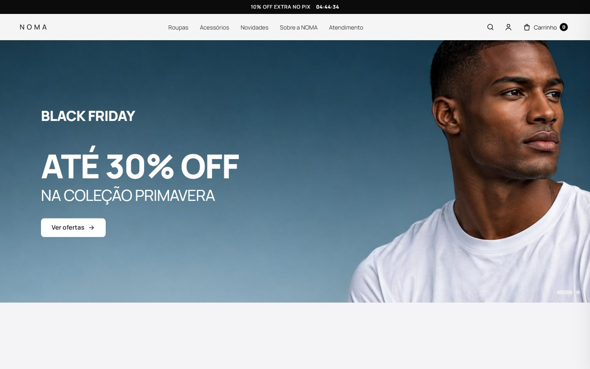
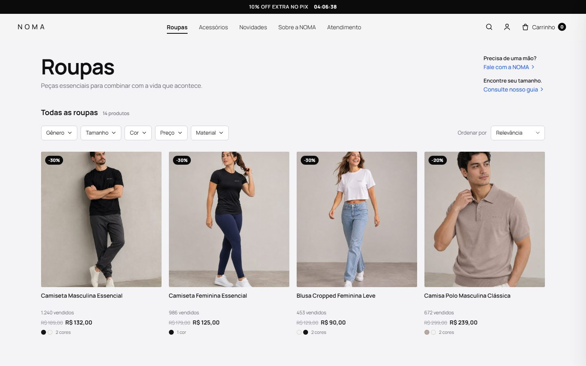
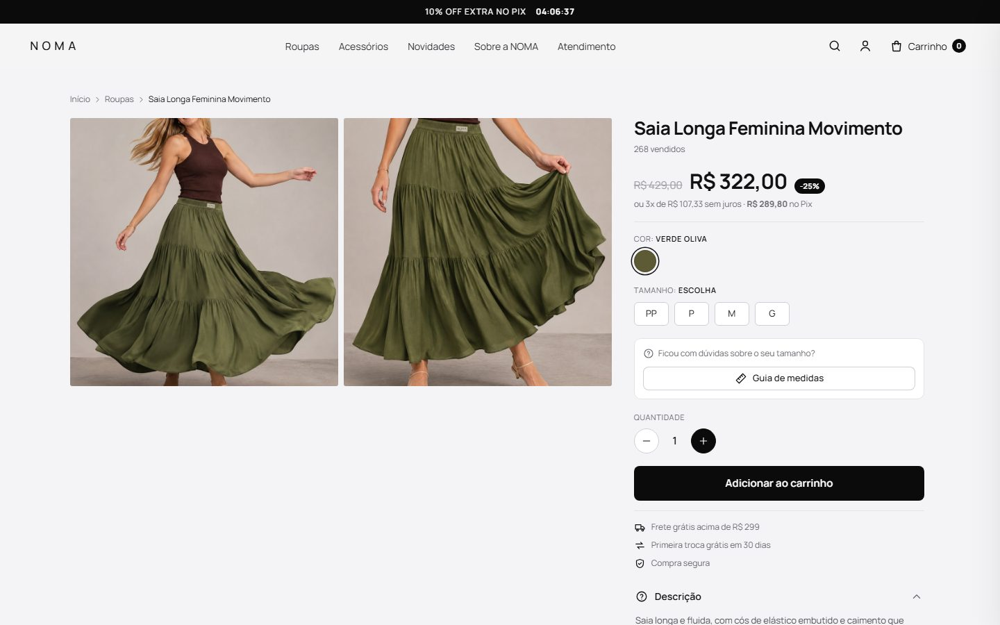

# NOMA — e-commerce com banco de dados poliglota

Trabalho da 3ª avaliação de **Projeto de Banco de Dados**. É uma loja de roupas e acessórios (**NOMA**) que usa três bancos, cada um onde ele é mais forte:

| Banco | Papel no sistema |
|---|---|
| **Supabase** (PostgreSQL + Auth) | Login do administrador, auditoria de acessos, pedidos e itens, configurações da loja |
| **MongoDB** | Cadastro e armazenamento dos produtos (documentos flexíveis), banners do carrossel e fotos enviadas (GridFS) |
| **Redis** | Produtos vistos recentemente, carrinho, cache do catálogo, ranking dos mais vistos e bloqueio de força bruta no login |



## Funcionalidades

**Loja (pública)**
- Página inicial com carrossel de banners, faixa promocional com contagem regressiva, "Ofertas da Black", acessórios, "Os queridinhos" e "Vistos recentemente".
- Listagens de Roupas, Acessórios, Novidades e Ofertas com filtros (gênero, tamanho, cor, preço e material), ordenação e "Ver mais", tudo sem recarregar a página.
- Busca ao vivo (atalho `/`).
- Página do produto com galeria, cores, tamanhos, guia de medidas, estoque, características (atributos livres do MongoDB) e avaliações de clientes.
- Carrinho em gaveta lateral: adicionar, alterar quantidade, remover (com "Desfazer") e total animado.
- **Finalizar compra:** o pedido é gravado no Supabase e o cliente é redirecionado ao WhatsApp com a mensagem pronta, por exemplo:
  `Olá, gostaria de pedir: 2x Camisa Polo Masculina Clássica (Dust Beige, M), 1x Cinto de couro. Total: R$ 627,00`

**Painel do administrador (restrito)**
- Login pelo **Supabase Auth**, com proteção CSRF, sessão nova a cada login e bloqueio por 15 min após 5 tentativas erradas (contador no Redis). Cada tentativa fica registrada na tabela `acessos_admin`.
- Dashboard com o status e a latência dos três bancos, KPIs, faturamento (view do Supabase), mais vistos (ZSET do Redis), últimos pedidos, acessos e os comandos recentes no Redis (HIT/MISS).
- Produtos: busca, ativar/desativar, excluir com confirmação e "ver documento no MongoDB".
- Cadastro/edição: fotos por upload (vão para o GridFS) ou link, cores, tamanhos, vitrine, **atributos dinâmicos** e prévia ao vivo do card.
- Pedidos com itens, mensagem enviada e troca de status.
- **Vitrine:** banners do carrossel (até 8) com textos, botão, imagens para computador e celular (upload em WebP no GridFS), cor, posição do texto, período de exibição (início e fim), ligar/desligar e ordem arrastando; tempo de cada banner e troca automática; faixa promocional do topo com texto, link, cores, contagem regressiva e data de término — tudo com prévia ao vivo.
- Configurações: número do WhatsApp e nome da loja.
- Formulários sem controles nativos do navegador: listas suspensas, paleta de cor, data e hora com máscara, números com − e + e controles deslizantes próprios (`static/js/ui.js` e `static/css/ui.css`).

Animações: revelação ao rolar, foto que "voa" até o carrinho, contador que pulsa, gaveta e modais com mola, botões com onda, tremida em erros, check animado no pedido, esqueletos de carregamento. Tudo respeita `prefers-reduced-motion`.

## Como rodar

### 1. Requisitos
Python 3.10+ (testado no 3.12) e contas gratuitas no [Supabase](https://supabase.com) e no [MongoDB Atlas](https://www.mongodb.com/atlas). Para o Redis, use Docker (`docker compose up -d`) ou um Redis gratuito na nuvem ([Upstash](https://upstash.com) ou [Redis Cloud](https://redis.io/cloud/)).

```bash
python -m venv .venv
.venv\Scripts\activate          # Windows  (Linux/Mac: source .venv/bin/activate)
pip install -r requirements.txt
copy .env.example .env          # Linux/Mac: cp .env.example .env
```

### 2. MongoDB Atlas
1. Crie um cluster gratuito (M0).
2. Em *Database Access*, crie um usuário. Em *Network Access*, libere o seu IP.
3. Em *Connect > Drivers > Python*, copie a URI para `MONGO_URI` no `.env`.

### 3. Supabase
1. Crie um projeto em supabase.com.
2. Em *Project Settings > API*, copie a **Project URL** para `SUPABASE_URL`, a chave **anon public** para `SUPABASE_ANON_KEY` e a **service_role** para `SUPABASE_SERVICE_ROLE_KEY`.
3. Em *Project Settings > Database > Connection string*, copie a URI do **Session pooler** para `DATABASE_URL` (troque `[YOUR-PASSWORD]` pela senha do banco).
4. Crie as tabelas e o administrador. O script pede a senha no terminal:

   ```bash
   python scripts/setup_supabase.py --email seu-email@exemplo.com --nome "Seu Nome"
   ```

   O script executa [`database/supabase.sql`](database/supabase.sql) e cria o usuário no Supabase Auth. Se preferir, cole o SQL no *SQL Editor* do Supabase e crie o usuário em *Authentication > Users > Add user*.

### 4. Redis
Use `REDIS_URL=redis://127.0.0.1:6379/0` com `docker compose up -d`, ou a URL `rediss://...` do Upstash/Redis Cloud.

### 5. Produtos de exemplo e servidor

```bash
python scripts/seed.py      # 18 produtos com fotos no MongoDB
python app.py               # http://127.0.0.1:5000
```

O painel fica em **http://127.0.0.1:5000/admin** (ou no ícone de pessoa no topo da loja).

> **Sem o Supabase Auth configurado** (sem `SUPABASE_URL`/`SUPABASE_ANON_KEY`), o login usa um modo local de desenvolvimento: a senha é conferida no próprio PostgreSQL com `pgcrypto`. O dashboard avisa quando isso acontece.

## Publicação na Vercel

Versão online: **https://noma-demo-six.vercel.app** (painel em `/admin`, acessado só pelo link).

O `vercel.json` publica o Flask como função Python (`@vercel/python`) e o `.vercelignore` deixa de fora `.env`, `.venv`, `docs/` e `scripts/`.
As variáveis do `.env` (menos `ADMIN_*`) ficam em *Project Settings → Environment Variables* na Vercel, com `SESSION_COOKIE_SECURE=1`.

```bash
npx vercel deploy --prod
```

Observações: use a `DATABASE_URL` do pooler do Supabase (porta 6543, sem `?pgbouncer=true`) e libere `0.0.0.0/0` no
*Network Access* do MongoDB Atlas. A Vercel aceita envios de até 4,5 MB por requisição, então fotos maiores devem ser reduzidas antes do upload.

## Desempenho (aparelhos fracos e redes lentas)

| Medida (página inicial) | Antes | Depois |
|---|---|---|
| HTML transferido | 35 KB | 7 KB (brotli) |
| CSS + JS transferidos | 83 KB | 20 KB |
| Imagens baixadas no celular | 874 KB | 184 KB |
| Tempo de resposta do servidor | 230 ms | 55 ms |

- **Imagens em WebP** com dois tamanhos (`srcset`): cards e carrinho usam a versão de 480 px; a página do produto usa 900 px só quando a tela pede. O banner do celular é uma imagem vertical própria e o segundo banner só baixa depois que a página carregou. Fotos enviadas pelo admin também viram WebP. Script: `python scripts/otimizar_imagens.py`.
- **Compressão brotli/gzip** (Flask-Compress) e **cache no navegador**: CSS e JS por 1 ano (o endereço muda a cada versão), imagens por 30 dias.
- **Fonte sem bloquear a página** (uma única fonte variável, carregada em paralelo).
- **Menos idas ao Redis**: configurações da loja guardadas 30 s na memória do servidor, visitante novo não consulta carrinho nem vistos, e "registrar visita + listar vistos" é um único comando (pipeline).
- **Modo leve automático**: com economia de dados, rede 2G/3G ou aparelho com pouca memória/processador, o site desliga desfoques, animações contínuas, troca de foto no hover e o carrossel automático. Em telas de toque a segunda foto do card nem é baixada. Partes longe da primeira tela (rodapé, avaliações, vistos) só são desenhadas quando chegam perto.

## Arquitetura

```
Navegador ──► Flask (Python)
               ├─ MongoDB ─── produtos, avaliações e fotos (GridFS)
               ├─ Supabase ── Auth (login) + PostgreSQL (pedidos, configurações e auditoria)
               └─ Redis ───── vistos, carrinho, cache, ranking e limite de login
```

| Arquivo | O que faz |
|---|---|
| `app.py` | Cria a aplicação, conecta os bancos, filtros de template e páginas de erro |
| `loja.py` | Rotas públicas e API JSON do carrinho, do pedido, da busca e das avaliações |
| `admin.py` | Login, dashboard, CRUD de produtos, pedidos e configurações |
| `bancos/mongo.py` | Consultas, filtros, `aggregate`, GridFS e validação de escrita |
| `bancos/supabase.py` | Supabase Auth (GoTrue), pool de conexões e chamadas SQL |
| `bancos/redis_store.py` | Listas, hashes, sorted sets, cache-aside com versão e contadores com TTL |
| `database/supabase.sql` | Tabelas, função `registrar_pedido`, view `vw_resumo_vendas` e RLS |
| `scripts/` | `setup_supabase.py` (tabelas + admin), `seed.py` (catálogo) e `otimizar_imagens.py` (WebP) |
| `templates/`, `static/` | Telas (Jinja2), CSS e JavaScript puro |

### MongoDB — documento de um produto

Cada produto pode ter campos diferentes em `atributos` (uma polo tem "Gola"; um óculos, "Proteção UV"), sem migração de esquema. As avaliações ficam embutidas no documento.

```json
{
  "slug": "camisa-polo-masculina-classica",
  "nome": "Camisa Polo Masculina Clássica",
  "categoria": "Roupas", "genero": "Masculino",
  "preco": 299.0, "preco_promocional": 239.0, "preco_final": 239.0,
  "estoque": 18, "vendidos": 672,
  "cores": [{"nome": "Dust Beige", "hex": "#b8a7a2"}],
  "tamanhos": ["P", "M", "G", "GG", "XGG"],
  "imagens": ["/static/img/produtos/polo-1.webp", "/imagem/6730f…"],
  "atributos": {"Gola": "Polo com 3 botões", "Tecnologia": "Controle térmico com grafeno"},
  "destaques": {"oferta": true, "queridinho": false, "novidade": false},
  "avaliacoes": [{"nome": "André L.", "nota": 5, "titulo": "Ótimo caimento", "…": "…"}],
  "ativo": true
}
```

### MongoDB — coleção `banners`

```json
{
  "chapeu": "Black Friday", "titulo": "Até 30% off", "subtitulo": "na coleção primavera",
  "botao_texto": "Ver ofertas", "botao_link": "/ofertas",
  "imagem": "/imagem/6731a…", "imagem_celular": "/imagem/6731b…",
  "cor_fundo": "#1d3a52", "tema": "claro", "alinhamento": "esquerda",
  "inicio": null, "fim": "ISODate", "ativo": true, "ordem": 1
}
```

### Supabase — PostgreSQL

| Objeto | Uso |
|---|---|
| `administradores` | Perfil de quem pode entrar (ligado a `auth.users`) |
| `acessos_admin` | Auditoria de cada tentativa de login |
| `pedidos` + `itens_pedido` | Pedido enviado ao WhatsApp e seus itens (`produto_id` aponta para o `_id` do MongoDB) |
| `configuracoes` | Número do WhatsApp, nome da loja, faixa promocional (texto, link, cores, contagem e término) e tempo do carrossel |
| `registrar_pedido(cliente, obs, itens jsonb)` | Função PL/pgSQL que grava pedido e itens numa transação e gera o código `NOMA-00001` |
| `vw_resumo_vendas` | Pedidos, faturamento, ticket médio e pedidos do dia |

Todas as tabelas têm **RLS ligado e nenhuma política**, então ninguém as lê pela API pública com a chave anon. O servidor acessa direto pelo Postgres.

### Redis — chaves

| Chave | Tipo | TTL | Uso |
|---|---|---|---|
| `noma:vistos:{visitante}` | LIST | 30 dias | `LREM` + `LPUSH` + `LTRIM` mantêm os 12 últimos produtos abertos |
| `noma:carrinho:{visitante}` | HASH | 7 dias | `produto|cor|tamanho` → quantidade |
| `noma:cache:v{N}:{consulta}` | STRING | 5 min | Cache-aside das vitrines, listagens e produtos |
| `noma:cache:v{N}:banners:no-ar` | STRING (JSON) | 60 s | Banners no ar agora (cache curto para respeitar o horário agendado) |
| `noma:cache:versao` | STRING | — | `INCR` quando o admin salva: invalida todo o cache de uma vez |
| `noma:ranking:views` | ZSET | — | `ZINCRBY` a cada visita, para os mais vistos |
| `noma:login:falhas:{ip}` | STRING | 15 min | Bloqueio após 5 tentativas erradas |
| `noma:stats` | HASH | — | Consultas e faltas do cache (taxa de acerto no dashboard) |

## Telas

| Listagem com filtros | Produto |
|---|---|
|  |  |

As telas da loja seguem o protótipo do Figma feito pela dupla. As do painel e a janela de finalização foram criadas no mesmo estilo. As fotos dos produtos e os banners são fictícios, gerados com IA.

## Documentação

- [Planejamento completo e roteiro do vídeo](docs/PLANEJAMENTO.md)
- [Briefing de telas enviado para o design](docs/briefing/Briefing%20de%20Telas.pdf)
